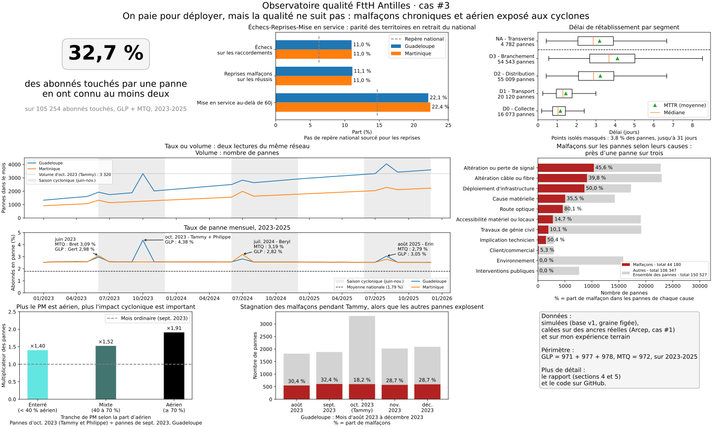

# FttH aux Antilles : quelle vision sur la qualité de service, et où agir ?

**Cas d'étude Data Analyst** · Maritza Brival · Guadeloupe · novembre 2026

> ⚠️ **Données simulées, étiquetées comme telles.** L'Arcep ne publie encore aucun indicateur de qualité FttH pour les outre-mer. Ce cas construit l'observatoire qui manque : les dénominateurs (locaux, abonnés, raccordements) sont réels, les pannes et raccordements sont simulés à partir de repères nationaux sourcés et d'un dire d'expert terrain documenté.



---

## Résumé

Mon premier cas d'étude, [« Déployer ou faire adopter ? »](https://github.com/mdbrivalast/capstone-ftth-antilles), a montré qu'aux Antilles la couverture fibre dépasse l'adoption, et laissait ouverte une hypothèse technique : la qualité de service, que l'Arcep ne mesure pas encore pour les outre-mer. Ce cas construit l'observatoire qui manque : huit indicateurs calculés sur 2023-2025, à partir de dénominateurs réels et de données simulées, documentées. Il montre une qualité en retrait du national dès l'entrée (11 % d'échecs au raccordement contre 6,3 %) et une panne qui revient chez près d'un abonné touché sur trois (32,7 %). Deux causes distinctes ressortent : la malfaçon, chronique, à l'origine de près d'une panne sur trois, et un réseau très aérien, que les cyclones frappent presque deux fois plus fort (×1,91 pendant Tammy). D'où deux leviers pour la Région Guadeloupe et la CTM, financeurs des RIP : la qualité du travail, en s'adressant au bon acteur selon la nature de la cause, et la résilience de l'aérien.

**Rapport complet** (démarche Ask → Act, contrôles, limites, annexes) : [`docs/FTTH-Antilles-qualite-de-service.pdf`](docs/FTTH-Antilles-qualite-de-service.pdf)

**Notebook Kaggle** (régénère la base, recalcule les 9 requêtes, vérifie qu'elles sont identiques aux résultats publiés, redessine les visuels) : [FttH Antilles · observatoire qualité de service](https://www.kaggle.com/code/maritzabrival/ftth-antilles-observatoire-qualit-de-service)

## La question

> Quels leviers peuvent être utilisés par la Région Guadeloupe et la CTM, sans attendre les données de l'Arcep et révélés par le modèle d'observatoire que je propose avec huit indicateurs, pour que les opérateurs concentrent leurs efforts sur la qualité de service ?

Périmètre : Martinique (972) et Guadeloupe, Saint-Barthélemy et Saint-Martin inclus (971 + 977 + 978), de janvier 2023 à décembre 2025 (36 mois, 3 saisons cycloniques).

## La démarche en bref

| Étape | Ce qui a été fait |
|---|---|
| **Prepare** | Repères nationaux sourcés (Arcep : 1,79 % d'abonnés en panne par mois, 6,27 % d'échecs au raccordement, 85,3 % de mises en service sous 60 jours), gabarit réglementaire des indicateurs, dires d'expert terrain documentés |
| **Process** | Modèle en étoile SQLite (9 tables, DDL v5.6), 135 triplets de causes (nature × tronçon × portée), générateur Python à graine figée : 1 580 PM, 235 000 abonnés, 181 488 raccordements, 150 527 pannes |
| **Analyze** | 8 indicateurs en SQL, lus deux fois : contrôle du simulateur (on retrouve ce qu'on a injecté), puis lecture métier |
| **Share** | 7 visuels + une tuile KPI en Matplotlib, réunis dans la planche ci-dessus |
| **Act** | Deux leviers techniques (qualité du travail, résilience de l'aérien) et un levier d'adoption, chacun avec ses indicateurs de suivi |

### Les 8 indicateurs (`sql/requetes/`)

| # | Indicateur | Fichiers |
|---|---|---|
| 1 | Issue des raccordements | `req_/res_indicateur01_raccordement_issue` |
| 2 | Reprise des malfaçons au raccordement | `req_/res_indicateur02_raccordement_reprise` |
| 3 | Délai de mise en service | `req_/res_indicateur03_delai_mes` |
| 4 | Taux de pannes mensuel | `req_/res_indicateur04_taux_pannes` |
| 5 | MTTR par segment | `req_/res_indicateur05_mttr` |
| 6 | Réitération (abonnés à ≥ 2 pannes) | `req_/res_indicateur06_reiteration` |
| 7 | Malfaçon par cause | `req_/res_indicateur07_malfacon-cause` |
| 7b | Malfaçon mois par mois autour de Tammy (appui du 4.3) | `req_/res_indicateur07b_malfacon_tammy` |
| 8 | Effet cyclone par tranche d'aérien des PM | `req_/res_indicateur08_cyclone_tranche-aerienpm` |

### Les visuels (`scripts/visuels/` → `images/`)

| Visuel | Message | Script |
|---|---|---|
| Tuile KPI | 32,7 % des abonnés touchés par une panne en ont connu au moins deux | `v0_tuile_reiteration.py` |
| 1 | Parité des deux territoires à l'entrée, en retrait du national | `v1_parite_entree.py` |
| 2+3 | Taux ou volume : deux lectures du même réseau | `v23_taux_vs_volume.py` |
| 4 | Plus la panne est proche de l'abonné, plus la réparation est longue | `v4_mttr_segment.py` |
| 5 | Près d'une panne sur trois vient d'une malfaçon | `v5_pannes_malfacon.py` |
| 6 | Plus le PM est aérien, plus l'impact cyclonique est important | `v6_cyclone_aerien.py` |
| 7 | Pendant Tammy, les malfaçons stagnent, les autres pannes explosent | `v7_dilution_tammy.py` |
| Planche | Les huit réunis sur une page | `planche_share.py` |

## Structure du dépôt

```
├── data/
│   ├── arcep/                      # CSV bruts de l'observatoire qualité FttH de l'Arcep (data.gouv.fr, juillet 2026)
│   ├── parc_annuel_reel.csv        # enveloppe réelle (locaux, abonnés, raccordements, PM) dérivée du cas précédent
│   ├── p_malfacon_mapping.csv      # propension de malfaçon par triplet de cause
│   └── ref_evenements_cycloniques.csv  # tempêtes et cyclones 2023-2025 (étiquettes des pics)
├── sql/
│   ├── DDL-capstone3-v5.6.sql          # schéma seul (modèle en étoile, 9 tables)
│   ├── DDL-capstone3-v5.6-peuple.sql   # schéma + référentiels : point de départ de la reproduction
│   ├── DDL-capstone3-v5.5*.sql         # version précédente, gardée pour l'historique
│   ├── peuplement_dim_cause.sql, peuplement_dim_temps.sql, ref_troncon_segment.sql
│   ├── patches/                        # évolutions successives du schéma
│   └── requetes/                       # les 8 indicateurs (+ 7b) : requête commentée et résultat sur la base v1
├── scripts/
│   ├── generateur_faits_cap3.py    # générateur des données simulées (graine figée)
│   ├── zapm_centroides_om.py       # comptage des PM outre-mer depuis le shapefile ZAPM de l'Arcep
│   ├── prototypes/moteur_pannes.py # maquette du moteur de pannes qui a servi à tester les réglages
│   └── visuels/                    # les 7 visuels, la tuile KPI et la planche (Matplotlib)
├── notebooks/
│   └── observatoire_qs_kaggle.ipynb  # notebook publié sur Kaggle : reproduction complète depuis le tag v1
├── docs/                           # rapport complet (PDF), note méthodologique, calibrage cyclonique, vérification sourcée des cyclones, schémas (.dot)
├── images/                         # visuels du Share (SVG), schéma du modèle en étoile, schéma du réseau FttH
└── CHANGELOG.md                    # historique des versions du modèle
```

## Reproduire l'analyse

Prérequis : Python 3 avec `pandas`, `numpy` et `matplotlib`. Toutes les commandes se lancent depuis la racine du dépôt.

```bash
# 1. Créer une base neuve à partir du schéma + référentiels (avec l'outil sqlite3)
sqlite3 cap3v5.db < sql/DDL-capstone3-v5.6-peuple.sql
#    ou, sans sqlite3, avec Python seul :
python -c "import sqlite3; c=sqlite3.connect('cap3v5.db'); c.executescript(open('sql/DDL-capstone3-v5.6-peuple.sql', encoding='utf-8').read()); c.commit()"

# 2. Générer les données simulées (graine figée = même résultat à chaque exécution)
python scripts/generateur_faits_cap3.py cap3v5.db

# 3. Redessiner les visuels (ils lisent sql/requetes/ et cap3v5.db, et écrivent dans images/)
python scripts/visuels/planche_share.py
```

Résultat attendu (contenu identique table par table à la base de l'analyse) :

| Table | Lignes |
|---|---|
| dim_temps | 36 |
| dim_pm | 1 580 |
| dim_abonne | 235 000 |
| fait_raccordement | 181 488 |
| fait_signalisation | 150 527 |

Le générateur se termine par un `foreign_key_check` qui doit afficher 0 violation. La base n'est pas versionnée, puisqu'elle se régénère à l'identique. Limite connue : le générateur lit `dim_cause` sans `ORDER BY`, donc la reproduction exacte suppose aussi le même ordre d'insertion des causes (correction prévue en v2).

## Sources

- Arcep, [Observatoire de la qualité des réseaux en fibre optique, chiffres jusqu'à mars 2026](https://www.arcep.fr/cartes-et-donnees/nos-publications-chiffrees/qualite-des-reseaux-ftth/observatoire-de-la-qualite-des-reseaux-en-fibre-optique-les-chiffres-jusqua-mars-2026.html) ([PDF, juillet 2026](https://www.arcep.fr/fileadmin/cru-1790833284/user_upload/observatoire/qualite-FttH/juillet-2026/observatoire_qualite-reseaux-FttH_juillet2026.pdf))
- Arcep, [Observatoire qualité FttH, 6e édition (septembre 2025)](https://www.arcep.fr/fileadmin/cru-1790833284/user_upload/observatoire/qualite-FttH/septembre-2025/observatoire_qualite-reseaux-FttH_septembre2025.pdf) : repère de 7 à 9 % de malfaçons critiques
- Arcep, [Observatoire des marchés 2025, outre-mer (juillet 2026)](https://www.arcep.fr/fileadmin/reprise/observatoire/march-an2025/obs-marches-2025-OUTRE-MER_juil2026.pdf)
- data.gouv.fr, [Qualité des réseaux en fibre optique](https://www.data.gouv.fr/datasets/qualite-des-reseaux-en-fibre-optique) et [Le marché du haut et très haut débit fixe : déploiements](https://www.data.gouv.fr/datasets/le-marche-du-haut-et-tres-haut-debit-fixe-deploiements)
- Réponse de l'Open Data Arcep sur le forum data.gouv.fr (07/10/2026)
- Interop'Fibre : protocoles SAV 2.1 et gestion des malfaçons
- TDF, indicateurs de qualité de service FttH : [Anjou Fibre](https://www.tdf.fr/sites/default/files/qsfibre_2021_05_anfi.pdf) et [Val-d'Oise Fibre](https://www.tdf.fr/sites/default/files/qsfibre_2021_05_vofi.pdf) (mai 2021)
- Vérification sourcée de l'historique cyclonique 2023-2025 : [`docs/verifSyntheseCyclone2023-2025.md`](docs/verifSyntheseCyclone2023-2025.md)

## À propos

Maritza Brival, data analyst (certificat Google Data Analytics), basée en Guadeloupe. Ancienne technicienne fibre optique (raccordement et SAV) aux Antilles : ce terrain nourrit les dires d'expert du modèle. Cas d'étude précédent : [capstone-ftth-antilles](https://github.com/mdbrivalast/capstone-ftth-antilles).
